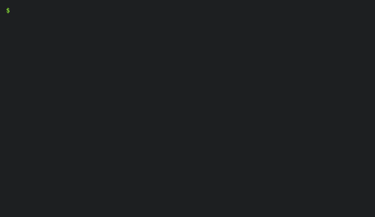

# grademe_python

Clone local d'`examshell` pour s'entraîner aux exercices Python du **Rank 03**
de l'école 42. Il reproduit le déroulé de l'examen : sujet tiré au sort,
fichier à rendre dans `rendu/`, correction automatique et score en
pourcentage.

> Projet non officiel, outil d'entraînement personnel sans affiliation avec
> l'école 42.



## Fonctionnalités

- interface TUI navigable au clavier (flèches ou `j` / `k`, Entrée, `q`)
- mode examen : un sujet aléatoire, avec filtre de difficulté optionnel
- mode entraînement : tu choisis le sujet dans la liste
- mode challenge : tous les sujets, de easy à hard
- historique des sessions passées
- correcteur automatique dans un sous-processus isolé (timeout 5 s)

Aucune dépendance externe : Python 3.10 ou plus et `make` suffisent.
La navigation clavier repose sur `termios` et `tty`, donc Linux ou macOS.

## Installation

```sh
git clone https://github.com/simPly-invent/grademe_python_RANK3.git
cd grademe_python_RANK3
make
```

## Utilisation

```sh
make              # interface interactive (menu TUI)
make exam         # examen rapide, sujet aléatoire
make challenge    # mode challenge complet
make status       # session en cours et chrono
make grademe      # corrige le fichier dans rendu/
make finish       # termine la session
make history      # sessions passées
make clean        # remet à zéro la session et rendu/
```

Ou directement en Python :

```sh
python3 examshell.py start          # sujet aléatoire
python3 examshell.py start -d easy  # filtre par difficulté
python3 examshell.py grademe
python3 examshell.py finish
```

### Déroulé type

1. `make`, puis "Commencer un examen" et choix de la difficulté
2. ouvre `rendu/<sujet>.py` dans ton éditeur et code la solution
3. `make grademe` pour la correction automatique
4. à 100 %, `make finish` pour le bilan et la sauvegarde dans l'historique

## Sujets disponibles (Rank 03)

| #  | Sujet                 | Difficulté |
|----|-----------------------|------------|
| 01 | Number Base Converter | medium     |
| 02 | Mirror Matrix         | easy       |
| 03 | Bracket Validator     | medium     |
| 04 | Is Anagram            | easy       |
| 05 | Alternate Case        | easy       |
| 06 | Caesar Cipher         | easy       |
| 07 | Sort Words            | hard       |
| 08 | Is Palindrome         | easy       |
| 09 | Find Runner Up        | easy       |
| 10 | Count Islands         | hard       |
| 11 | Longest Consecutive   | hard       |
| 12 | Matrix Transposition  | easy       |

## Correcteur

`grader.py` exécute ta fonction dans un sous-processus isolé, compare les
sorties aux résultats attendus et renvoie un score :

```
  OK  Test 1/4
  OK  Test 2/4
  KO  Test 3/4  attendu=True  obtenu=None
  OK  Test 4/4

  Score : [####################..........] 75%  (3/4 tests)
```

## Ajouter des sujets

Les sujets sont définis dans `subjects/rank03.json` :

```json
{
  "id": "py_mon_sujet",
  "title": "Mon Sujet",
  "difficulty": "easy",
  "assignment": "Description de l'exercice.",
  "signature": "def mon_sujet(x: int) -> int:",
  "tests": [
    {"input": [[42]], "expected": 84}
  ]
}
```

## Structure

```
.
├── Makefile              commandes principales
├── examshell.py          CLI (start / status / grademe / finish)
├── grader.py             correcteur automatique
├── display.py            affichage ANSI
├── menu.py               interface TUI
├── subjects/rank03.json  12 sujets avec leurs tests
├── sessions/             historique (créé automatiquement)
└── rendu/                ton fichier à rendre (créé automatiquement)
```

## Auteur

mobenais, étudiant à 42.
